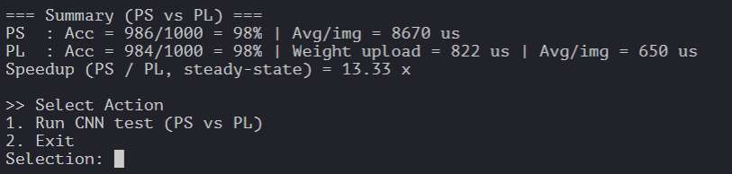
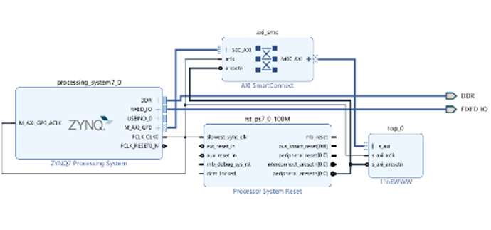
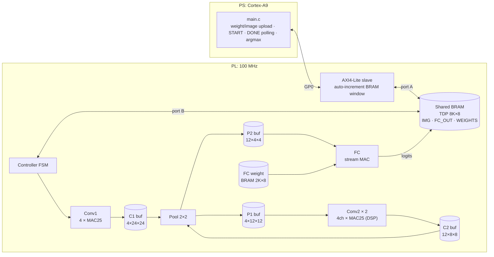
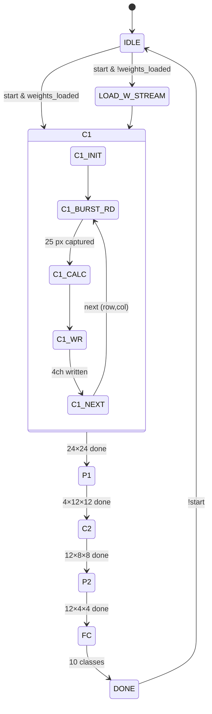
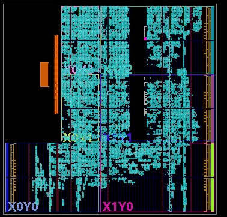

# Zynq-7020 MNIST CNN Inference Accelerator

Zynq-7000 SoC(Arty Z7-20, xc7z020clg400-1)의 PL에 **int8 CNN 추론 가속기**를 SystemVerilog로 설계하고, PS(Cortex-A9) 소프트웨어 추론 대비 성능·정확도를 1,000장 MNIST로 비교한 프로젝트입니다.

> 경희대학교 전자공학과 SoC Design 팀 프로젝트 (4인, 2025-2학기) · Vivado 2024.2

## 결과 요약

| 항목 | PS (ARM Cortex-A9 @ 650 MHz, C) | PL 가속기 (@ 100 MHz) |
|---|---|---|
| 정확도 (MNIST test 1,000장) | 98.6% (986/1000) | **98.4% (984/1000)** |
| 이미지당 평균 시간 | 8,670 µs | **650 µs** |
| Speedup | 1× | **13.33×** |
| 가중치 업로드 (1회, 3,220 B) | – | 822 µs |

- PL 시간은 이미지 전송(AXI4-Lite, 784 B) + 연산 + 결과 10 B 읽기를 포함한 PS 측 측정값 (Global Timer 기준)
- 구현 결과: **WNS +0.078 ns @ 100 MHz** (timing met), LUT 33.7%, FF 17.7%, BRAM 5 tile(3.6%), **DSP 200/220 (90.9%)**



## 네트워크

LeNet-1 계열 소형 CNN, 가중치·활성값 모두 8-bit (bias 없음). 학습·양자화된 int8 가중치는 수업에서 제공받았으며, 본 프로젝트의 범위는 이 가중치로 동작하는 추론 하드웨어 설계입니다.

| Layer | 입력 | 커널 | 출력 | MACs | 파라미터 (B) | HW 병렬도 |
|---|---|---|---|---|---|---|
| Conv1 + ReLU | 1×28×28 | 4 × (1×5×5) | 4×24×24 | 57,600 | 100 | MAC25 × 4 (출력 채널 병렬, LUT 곱셈기) |
| Pool1 | 4×24×24 | 2×2 max, s=2 | 4×12×12 | – | – | 1 |
| Conv2 + ReLU | 4×12×12 | 12 × (4×5×5) | 12×8×8 | 76,800 | 1,200 | MAC25 × 4ch × 2 unit (DSP 200개) |
| Pool2 | 12×8×8 | 2×2 max, s=2 | 12×4×4 | – | – | 1 (Pool1 유닛 재사용) |
| FC | 192 | 10 × 192 | 10 | 1,920 | 1,920 | 1 MAC/cycle 스트리밍 |
| **합계** | | | | **136,320** | **3,220** | |

양자화: Conv 출력은 `ReLU → (acc + 64) >>> 7 → [0, 255] clamp`, FC 출력은 `(acc + 8) >>> 4 → [0, 255] clamp` 후 PS에서 argmax.
FC shift(`>>>4`) 근거 — TB 내장 100장에 대한 bit-exact 모델 분석(`tools/quant_analysis.py`): FC 누산값은 −3,016 \~ +4,219(13 bit). `>>>4`에서 정답 logit이 87\~255로 8-bit 범위를 거의 채우고(포화 1/100장), top1–top2 최소 마진이 16 LSB로 `>>>3`(포화 82장, 마진 5)·`>>>5`(포화 0장, 마진 8)보다 큼. 정확도는 `>>>3`\~`>>>8` 모두 100/100으로 동일.

## 시스템 구조





### 추론 시퀀스 (PS ↔ PL)

1. **Weight load (최초 1회)**: PS가 3,220 B를 공유 BRAM `0x0600~`에 기록 → 첫 START 시 `LOAD_W_STREAM`이 Conv1/Conv2 가중치는 레지스터(`w_c1`, `w_c2`)로, FC 가중치는 전용 BRAM으로 복사
2. **Image write**: 28×28 = 784 B를 `0x0000~`에 기록
3. **START** (`CTRL[5]=1`) → Conv1 → Pool1 → Conv2 → Pool2 → FC 순차 실행
4. **DONE polling** (`STATUS[4]`) → `0x0400~`에서 logits 10 B 읽기 → PS에서 argmax

## 마이크로아키텍처

### MAC25 (`mac.sv`, `mac_dsp.sv`)
- 5×5 window 25개 곱셈을 1 cycle에 병렬 수행 후 **5-stage adder tree** (16→17→…→21 bit, bit-growth 반영)
- 고정 **latency 6 cycle**, `start`를 6-bit shift register로 지연시켜 1-cycle `done` pulse 생성
- unsigned 픽셀은 `{1'b0, px}`로 부호 확장 후 signed 가중치와 곱셈
- `mac_dsp`는 `(* use_dsp = "yes" *)`로 곱셈을 DSP48E1에 매핑 (Conv2 전용), `mac`은 Conv1용

### Conv1 / Conv2 (`conv1.sv`, `conv2.sv`)
- **Conv1**: 1개의 5×5 입력 window를 MAC25 4개가 공유 → 출력 채널 4개 동시 계산
- **Conv2**: 입력 채널 4개 window를 MAC25 4개가 병렬 처리 → 채널 합산(23 bit) → 양자화. Controller에서 Conv2 유닛 **2개**를 인스턴스해 출력 채널 2개씩 × 6회로 12채널 처리
- DSP 200개 = Conv2 유닛 2 × 입력 4ch × 25 tap과 일치

### FC (`fc.sv`)
- P2 버퍼(192 B)와 FC weight BRAM을 매 cycle 1개씩 읽어 들이는 **2-stage (mul → acc) 스트리밍 MAC**, `use_dsp = "no"`로 LUT 구현
- 입력이 0이면 곱셈 결과를 0으로 강제하고 누산기 갱신 생략 (ReLU 이후 희소성 활용)

### Controller FSM (`controller.sv`)



- **Request/Acknowledge 분리 burst read**: 주소 요청 카운터(`*_req`)와 데이터 수신 카운터(`*_ack`)를 분리해, BRAM read latency(주소 레지스터 1 + BRAM 1 = 2 cycle) 동안 멈추지 않고 매 cycle 주소를 발행 → window 로드·가중치 로드·FC 스트림 모두 초기 2 cycle 이후 **1 B/cycle**
- FC 단계: FC weight BRAM은 출력 레지스터 사용(latency 2) + 조합 주소, P2 버퍼는 등록 주소 + latency 1 → 두 스트림 모두 요청 2 cycle 후 도착
- 레이어 간 버퍼는 모두 별도 Simple Dual-Port BRAM (8-bit)

### AXI4-Lite 인터페이스 (`rtl/axi/`)

범용 AXI BRAM Controller 대신, 주소 1회 설정 후 데이터 레지스터 접근마다 BRAM 주소를 자동 증가시키는 **auto-increment window**를 구현했습니다.

| Offset | 이름 | 설명 |
|---|---|---|
| `0x08` | BRAM_ADDR | write: 내부 주소 카운터 설정 / read: 현재 카운터 |
| `0x0C` | BRAM_DATA | write/read 1회마다 BRAM 1 B 접근 + 주소 +1 (read는 `rvalid` 1-cycle 지연으로 BRAM latency 보정) |
| `0x14` | STATUS | `[4]` DONE |
| `0x18` | CTRL | `[5]` START |

공유 BRAM 메모리 맵: `0x0000` 이미지(784 B) · `0x0400` FC 출력(10 B) · `0x0600` 가중치(Conv1 100 + Conv2 1,200 + FC 1,920 B)

## 구현 결과 (Post-implementation, `reports/`)

| 자원 | 사용 | 가용 | 비율 |
|---|---|---|---|
| Slice LUT | 17,905 | 53,200 | 33.7% |
| Slice Register | 18,816 | 106,400 | 17.7% |
| Block RAM Tile | 5 | 140 | 3.6% |
| DSP48E1 | 200 | 220 | 90.9% |

| Timing @ 100 MHz (FCLK0) | 값 |
|---|---|
| WNS / TNS | +0.078 ns / 0 |
| WHS | +0.018 ns |
| Worst setup path | → `u_c2_1/MAC_4CH[3].u_mac/mul_res_reg` (DSP A 입력), data path 9.427 ns 중 **route 74%** |
| On-chip power (Vivado 추정, PS7 포함) | 1.819 W |

- Conv1/Conv2 가중치 1,300 B(10,400 bit)를 레지스터에 저장 → Conv2 커널 선택(`w_c2[c2_out_idx]`) mux가 DSP 입력까지 넓은 fan-in 경로를 만들며, 이것이 critical path가 route 지배적인 원인으로 판단



## 설계 공간 탐색 (미채택안 포함)

| 구조 | PL 정확도 | 이미지당 | Speedup | Weight upload | 결론 |
|---|---|---|---|---|---|
| **Baseline**: AXI4-Lite + 병렬 MAC | 98.4% | 650 µs | 13.33× | 822 µs | **채택** |
| MAC 유닛 통합 (compute unit 1개) | – | – | 4.27× | – | 면적 감소 대비 성능 손실 커서 미채택 |
| AXI-Stream 64-bit (DMA) + 데이터 레지스터 저장 | 97.9% | 915 µs | 9.24× | 103 µs | weight upload 8× 단축, 대신 LUT 72%·이미지 전송 증가로 미채택 |
| AXI-Stream 64-bit (DMA) + BRAM 저장 | 47.9% | 457 µs | (18.50×) | 102 µs | BRAM write/read 데이터 오류로 **기능 실패**, 일정상 미해결 |

AXI-Stream 실험 로그: [레지스터 저장](docs/img/dse_axis_reg.png) · [BRAM 저장](docs/img/dse_axis_bram.png)

## 검증

- `sim/controller_tb.sv`: 가중치 3,220 B와 MNIST 이미지 100장·라벨을 TB에 내장, behavioral BRAM 모델로 컨트롤러를 구동하고 FC 출력 argmax를 라벨과 비교하는 self-checking TB
- TB는 확장 주소 맵 버전 `sim/controller_1.sv`(주소 폭 16 bit, `ADDR_FC=0x1000`, `ADDR_WEIGHTS=0x2000`)를 DUT로 사용하며, 이 외 로직은 `rtl/controller.sv`와 동일
- On-board: PS C 레퍼런스와 동일 1,000장에 대해 정확도·시간 비교 (위 결과)

## 한계와 개선 방향

1. **Window 재사용 없음**: 출력 픽셀마다 5×5 window 25 B를 BRAM에서 다시 읽음 → line buffer + sliding window로 Conv1 입력 읽기를 출력당 25 → 5 B 이하로 축소 가능
2. **레이어 간 순차 실행**: Conv1 → … → FC가 직렬, 레이어 간 파이프라이닝·이미지 간 double buffering 없음
3. **PS↔PL 전송 병목**: AXI4-Lite 트랜잭션당 1 B → 가중치 3,220 B 업로드 822 µs(≈255 ns/B). AXI-Stream/DMA 경로는 BRAM 데이터 오류 해결이 선결 과제
4. **가중치 레지스터 저장**: FF·mux 증가 및 critical path 원인 → 가중치 BRAM 뱅킹 또는 mux 출력 레지스터링
5. PS(986) vs PL(984) 결과가 2장 다름 → PS C 레퍼런스와 RTL의 양자화 비트 정합성 확인 필요

## My Role (박시온)

4인 팀 중 담당 파트:

- **Controller FSM**: weight stream load, request/ack 분리 burst window read, Conv2 2-unit 병렬 스케줄링, 레이어 간 버퍼 주소 생성
- **연산 유닛 RTL**: MAC25(adder tree, LUT/DSP 버전), Conv1/Conv2, Pool, FC 및 출력 requantization(shift·ReLU·clamp) 로직
- **검증·설계 공간 탐색**: self-checking TB, compute unit 통합 / AXI-Stream 구조 실험 및 비교

AXI4-Lite 인터페이스와 PS 펌웨어는 팀원이 담당했습니다.

## 디렉터리 구조

```
rtl/            top, controller, conv1/conv2, mac/mac_dsp, pool1, fc
rtl/axi/        AXI4-Lite slave (auto-increment BRAM window)
ip/             Block Memory Generator 설정 (.xci)
sim/            self-checking testbench + sim용 controller 변형
sw/main.c       PS 측 벤치마크 (PS vs PL, 1,000장)
hw/design_1.bd  Zynq PS7 + SmartConnect + CNN IP block design
reports/        utilization / timing / power (post-route)
tools/          RTL bit-exact Python 모델, 양자화 분석
```

## 재현 방법

1. Vivado 2024.2에서 board Arty Z7-20(part `xc7z020clg400-1`) 프로젝트 생성 → `rtl/`, `rtl/axi/`, `ip/*.xci` 추가, top = `top` → IP Packager로 패키징
2. Block design에 ZYNQ7 PS(FCLK0 100 MHz) + AXI SmartConnect + 패키징한 IP 연결 (`hw/design_1.bd` 참고) → bitstream / XSA 생성
3. Vitis에서 `sw/main.c` 빌드 후 UART 터미널에서 `1` 입력

> `sw/main.c`가 include하는 `cnn_common.h`(학습된 int8 가중치, MNIST 테스트셋 1,000장, PS C 레퍼런스 `ps_forward_one`)는 이 저장소에 포함되어 있지 않습니다.
